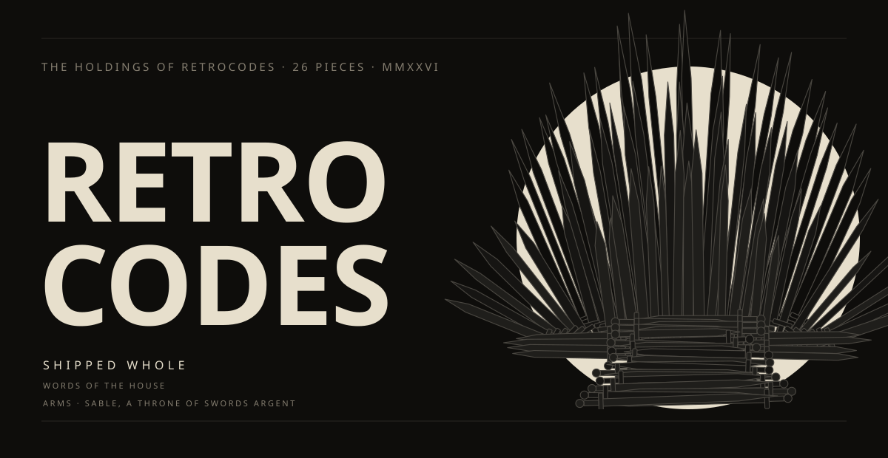

<picture><source media="(prefers-color-scheme: dark)" srcset="assets/s1-dark.svg">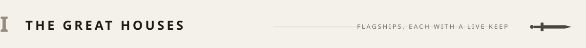</picture>

<a href="https://github.com/retrocodes12/machine-room"><picture><source media="(prefers-color-scheme: dark)" srcset="assets/strip-machine-room-dark.svg">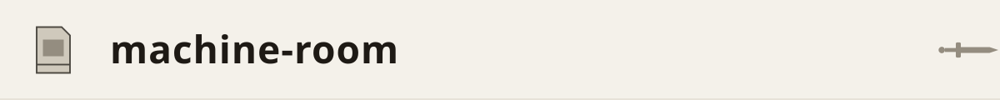</picture></a> 
A Game Boy emulator: SM83, scanline PPU, four-voice sound, in 1,164 lines with no dependencies. Passes Blargg's CPU tests and renders dmg-acid2 pixel-perfect. [Insert a cartridge](https://retrocodes12.github.io/machine-room/). 
2026 · ZERO DEPENDENCIES · HARDWARE-TEST VERIFIED

<a href="https://github.com/retrocodes12/sculpture-hall"><picture><source media="(prefers-color-scheme: dark)" srcset="assets/strip-sculpture-hall-dark.svg">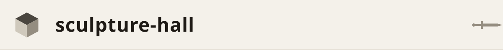</picture></a> 
A 3D renderer with no GPU: matrices, near-plane clipping, z-buffer, perspective-correct texturing, written longhand. [Walk the hall](https://retrocodes12.github.io/sculpture-hall/), or drop your own .obj onto the plinth. 
2026 · ZERO DEPENDENCIES · ZERO WEBGL · 36 TESTS

<a href="https://github.com/retrocodes12/NebulaStreams-V2"><picture><source media="(prefers-color-scheme: dark)" srcset="assets/strip-nebulastreams-dark.svg">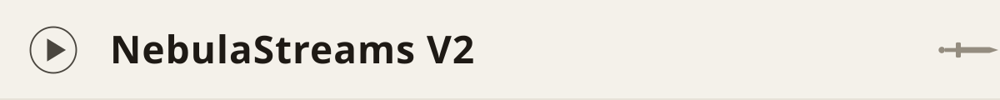</picture></a> 
Hybrid streaming server: torrent streaming, HTTP proxying, and a disk-backed cache. 
2026 · JAVASCRIPT · ★ 8

<a href="https://github.com/retrocodes12/nebula-player"><picture><source media="(prefers-color-scheme: dark)" srcset="assets/strip-nebula-player-dark.svg">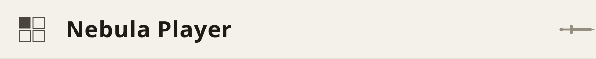</picture></a> 
One streaming player, four rooms: [web](https://retrocodes12.github.io/nebula-player/), [Android](https://github.com/retrocodes12/nebula-android), [desktop](https://github.com/retrocodes12/nebula-desktop), and a shared [watch-party](https://github.com/retrocodes12/nebula-party). 
2026 · TYPESCRIPT + KOTLIN · ★ 2

<a href="https://github.com/retrocodes12/trustpacket"><picture><source media="(prefers-color-scheme: dark)" srcset="assets/strip-trustpacket-dark.svg">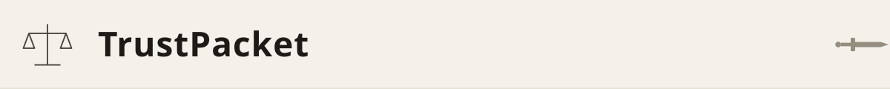</picture></a> 
Three-way trust reconciliation for law-firm client accounts. Two exports in, a signed packet out. 
2026 · NODE + SQLITE · NO EXTERNAL SERVICES

<a href="https://github.com/retrocodes12/flowwatch"><picture><source media="(prefers-color-scheme: dark)" srcset="assets/strip-flowwatch-dark.svg">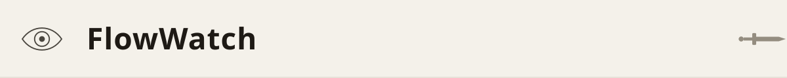</picture></a> 
Cross-client monitoring for n8n and Make automations, with white-label monthly reports ([site](https://retrocodes12.github.io/flowwatch-site/)). 
2026 · JAVASCRIPT · ZERO DEPENDENCIES

<a href="https://github.com/retrocodes12/the-last-samurai-film"><picture><source media="(prefers-color-scheme: dark)" srcset="assets/strip-last-samurai-dark.svg">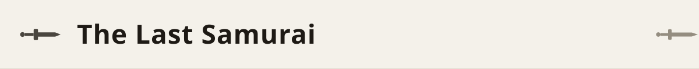</picture></a> 
A wordless cinematic scroll film in six movements. No dialogue, no chrome; the scrollbar is the projector. 
2026 · HTML · ONE PAGE

<a href="https://github.com/retrocodes12/monochrome-android"><picture><source media="(prefers-color-scheme: dark)" srcset="assets/strip-monochrome-dark.svg">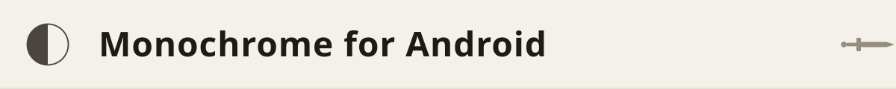</picture></a> 
A Spotify-style Monochrome client packaged as an Android app. 
2026 · JAVASCRIPT · ★ 2

<picture><source media="(prefers-color-scheme: dark)" srcset="assets/s2-dark.svg">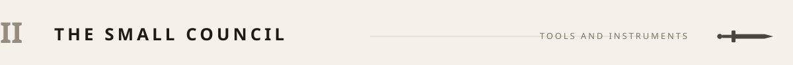</picture>

<a href="https://github.com/retrocodes12/graph-graffiti"><picture><source media="(prefers-color-scheme: dark)" srcset="assets/strip-graph-graffiti-dark.svg">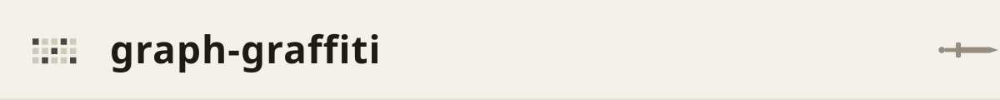</picture></a> 
Draw text and sprites on a contribution graph in backdated empty commits. The studio behind the arcade wing, cleaned up and handed to visitors. 
2026 · NODE · ONE FILE · ZERO DEPENDENCIES

<a href="https://github.com/retrocodes12/arcade-cabinet"><picture><source media="(prefers-color-scheme: dark)" srcset="assets/strip-arcade-cabinet-dark.svg">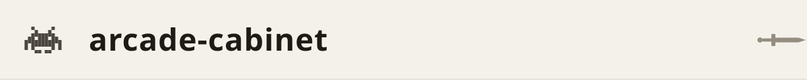</picture></a> 
Space Invaders in the terminal. The invaders on [the graph](https://github.com/retrocodes12/arcade-wing) don't move; these do. 
2026 · NODE · 385 LINES · ONE COLOR SPENT ON BULLETS

<a href="https://github.com/retrocodes12/print-room"><picture><source media="(prefers-color-scheme: dark)" srcset="assets/strip-print-room-dark.svg">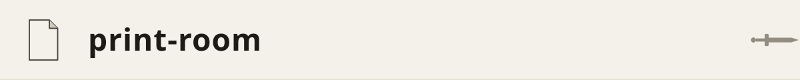</picture></a> 
A poster press. Every [visit](https://retrocodes12.github.io/print-room/) prints a numbered edition from the collection's identity; the number in the URL is the poster. 
2026 · ONE HTML FILE · EDITION OF ONE

<a href="https://github.com/retrocodes12/the-vault"><picture><source media="(prefers-color-scheme: dark)" srcset="assets/strip-the-vault-dark.svg">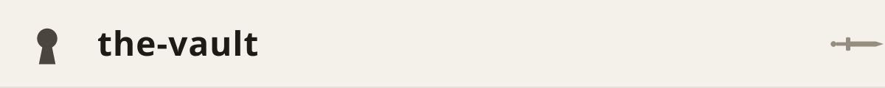</picture></a> 
The storage basement, navigable entirely in markdown. The receiving books run to 27. This page says 26. Someone should look into that. 
2026 · NO CODE · 17 ROOMS · ONE MISSING EXHIBIT

<picture><source media="(prefers-color-scheme: dark)" srcset="assets/s3-dark.svg">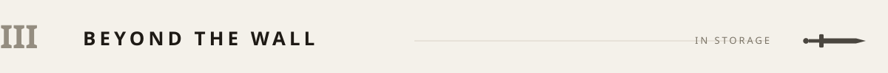</picture>

North of the Wall, in storage: an emergency-line triage engine, an app that locks a phone against its owner's worse instincts, an invoice tool on its second payment processor, an intent radar for a noisy social network, and a reorder planner for shopkeepers.

STORAGE IS NOT EXILE · PIECES RETURN

<picture><source media="(prefers-color-scheme: dark)" srcset="assets/s4-dark.svg">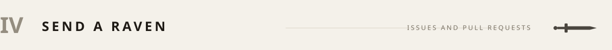</picture>

The realm is kept by one person. Every holding accepts issues and pull requests; that is how a raven is sent. New pieces appear without banners.

THE GATES ARE ALWAYS OPEN · NO TOLL

<picture><source media="(prefers-color-scheme: dark)" srcset="assets/s5-dark.svg">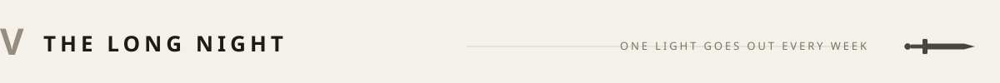</picture>

CATALOGUE REV. 2026-09 · THE GATES ARE ALWAYS OPEN

