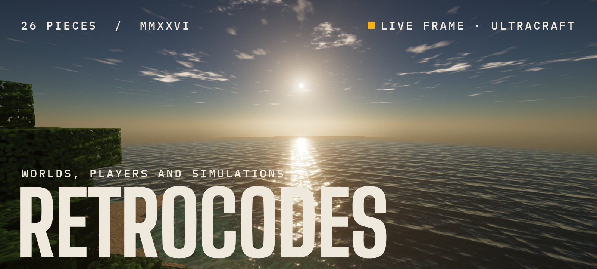
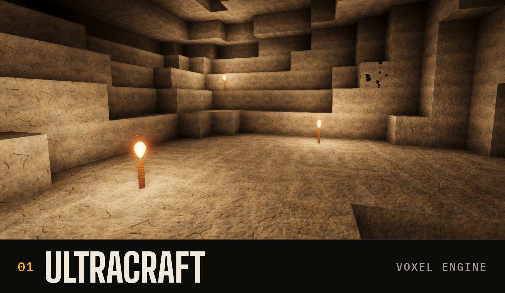
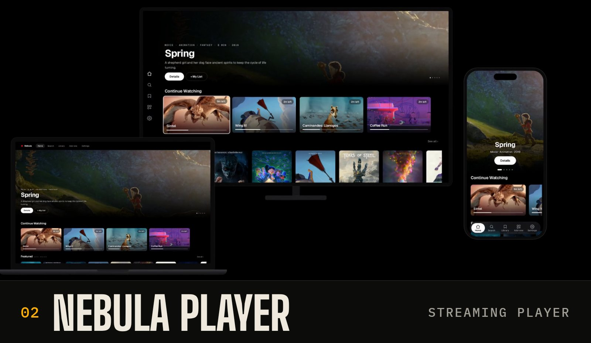
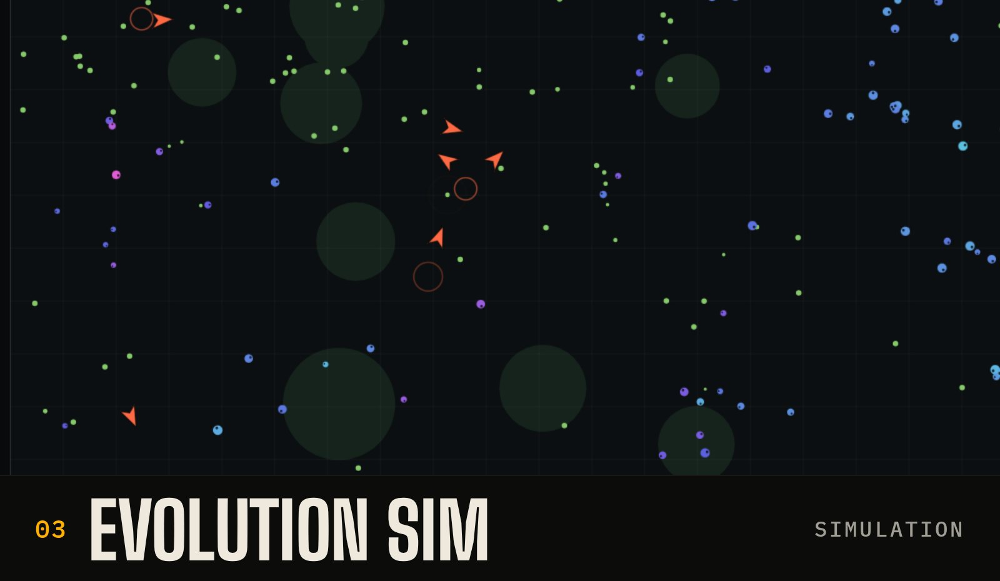
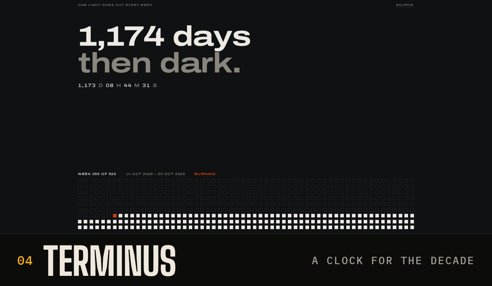
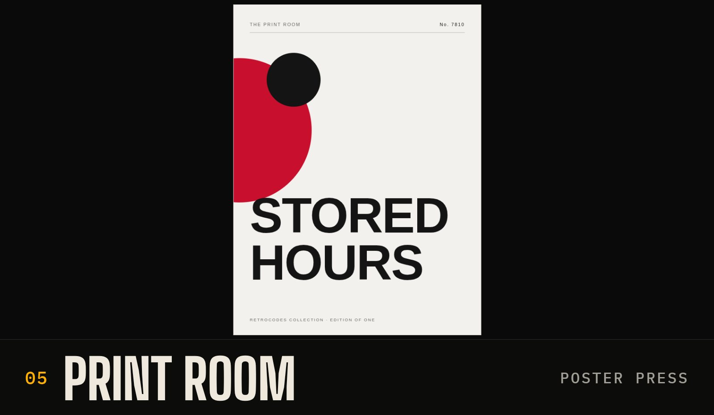

<a href="https://github.com/retrocodes12/ultracraft"><picture><source srcset="assets/hero.webp" type="image/webp"></picture></a>

Software built end to end by one person: a game engine that renders in a browser tab, a streaming player on seven platforms, a simulation where species split on their own. Each one below runs; click a picture for the source.

A Minecraft-style sandbox in one HTML file, pushed toward real light: procedural PBR textures, a physical sky, cascaded shadows, reflective water. [Play it in the browser](https://retrocodes12.github.io/ultracraft/). 
THREE.JS · NO TEXTURE FILES · 4,600 LINES · [SOURCE](https://github.com/retrocodes12/ultracraft)

 

A free player for the TV, the desktop and the phone. Add a source and it becomes a library with artwork, episode lists, subtitles, and your place kept across screens. One shared player for the web and LG webOS, plus native apps for [Android and Android TV](https://github.com/retrocodes12/nebula-android), [Windows](https://github.com/retrocodes12/nebula-desktop) and [macOS](https://github.com/retrocodes12/nebula-mac). [play.rifflehq.in](https://play.rifflehq.in) 
TYPESCRIPT · KOTLIN · SWIFT · ★ 12 ACROSS FOUR REPOS · [SOURCE](https://github.com/retrocodes12/nebula-player)

 

Creatures with energy budgets and heritable genes, and nothing scripted past that. Predator–prey arms races, genealogies and new species emerge on their own; rewind, branch and compare timelines. [Run it](https://retrocodes12.github.io/evolution-sim/). 
VANILLA JS · ZERO DEPENDENCIES · MULTI-SEED TESTS · [SOURCE](https://github.com/retrocodes12/evolution-sim)

 

The 522 weeks of the 2020s as a wall of lights. One goes out every week until 00:00 UTC, 1 January 2030, and a daily Action commits the count. [Watch it happen](https://retrocodes12.github.io/terminus/). 
ONE PAGE · ONE ACTION · 522 LIGHTS · [SOURCE](https://github.com/retrocodes12/terminus)

 

Every [visit](https://retrocodes12.github.io/print-room/) prints a numbered poster from the collection's identity. The edition number in the URL is the poster: same number, same print, forever. 
ONE HTML FILE · NO BUILD · NO LIBRARIES · [SOURCE](https://github.com/retrocodes12/print-room)

 

### Also on the shelf

- **[graph-graffiti](https://github.com/retrocodes12/graph-graffiti)** · Draws text and sprites on a contribution graph with backdated empty commits. [arcade-wing](https://github.com/retrocodes12/arcade-wing) is five invaders drawn that way, in 2,100 commits.
- **[context-relay](https://github.com/retrocodes12/context-relay)** · A Claude Code mod that hands your work to a fresh session before a long context wears the model down, and keeps going there.
- **[rigor](https://github.com/retrocodes12/rigor)** · A fact-checking protocol for AI chatbots, with explicit countermeasures for the usual reasoning biases.
- **[sleeve](https://github.com/retrocodes12/sleeve)** · A Spotify-shaped music player, painted orange. [Open it](https://retrocodes12.github.io/sleeve/).
- **[NebulaStreams](https://github.com/retrocodes12/NebulaStreams)** · A Node streaming server: torrent streaming, HTTP proxying, and a disk-backed cache.

 

KEPT BY ONE PERSON · ISSUES AND PULL REQUESTS OPEN ON EVERY PUBLIC REPO · REV. 2026-10
