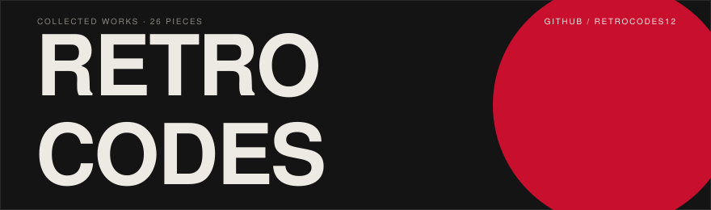

<picture>
  <source media="(prefers-color-scheme: dark)" srcset="assets/s01-dark.svg">
  
</picture>

**[NebulaStreams V2](https://github.com/retrocodes12/NebulaStreams-V2)** — hybrid streaming server: torrent streaming, HTTP proxying, and a disk-backed cache. 
2026 · JAVASCRIPT · ★ 7

**[Nebula Player](https://github.com/retrocodes12/nebula-player)** — one streaming player, four rooms: [web](https://retrocodes12.github.io/nebula-player/), [Android](https://github.com/retrocodes12/nebula-android), [desktop](https://github.com/retrocodes12/nebula-desktop), and a shared [watch-party](https://github.com/retrocodes12/nebula-party). 
2026 · TYPESCRIPT + KOTLIN · ★ 2

**[TrustPacket](https://github.com/retrocodes12/trustpacket)** — three-way trust reconciliation for law-firm client accounts. Two exports in, a signed packet out. 
2026 · NODE + SQLITE · NO EXTERNAL SERVICES

**[FlowWatch](https://github.com/retrocodes12/flowwatch)** — cross-client monitoring for n8n and Make automations, with white-label monthly reports ([site](https://retrocodes12.github.io/flowwatch-site/)). 
2026 · JAVASCRIPT · ZERO DEPENDENCIES

**[The Last Samurai](https://github.com/retrocodes12/the-last-samurai-film)** — a wordless cinematic scroll film in six movements. No dialogue, no chrome; the scrollbar is the projector. 
2026 · HTML · ONE PAGE

**[Monochrome for Android](https://github.com/retrocodes12/monochrome-android)** — a Spotify-style Monochrome client packaged as an Android app. 
2026 · JAVASCRIPT · ★ 2

<picture>
  <source media="(prefers-color-scheme: dark)" srcset="assets/s02-dark.svg">
  
</picture>

Pieces not currently on display: an emergency-line triage engine, an app that locks a phone against its owner's worse instincts, an invoice tool on its second payment processor, an intent radar for a noisy social network, and a reorder planner for shopkeepers.

STORAGE IS NOT ABANDONMENT · PIECES ROTATE

<picture>
  <source media="(prefers-color-scheme: dark)" srcset="assets/s03-dark.svg">
  
</picture>

The collection is maintained by one person. Every exhibit accepts issues and pull requests. New pieces appear without announcement.

THE COLLECTION IS PERMANENTLY OPEN · FREE ADMISSION

CATALOGUE REV. 2026-08

